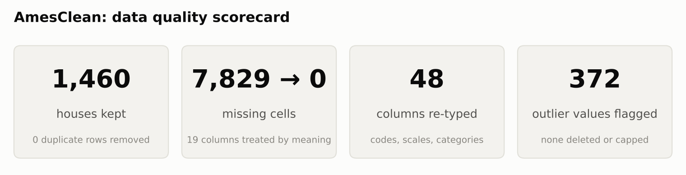
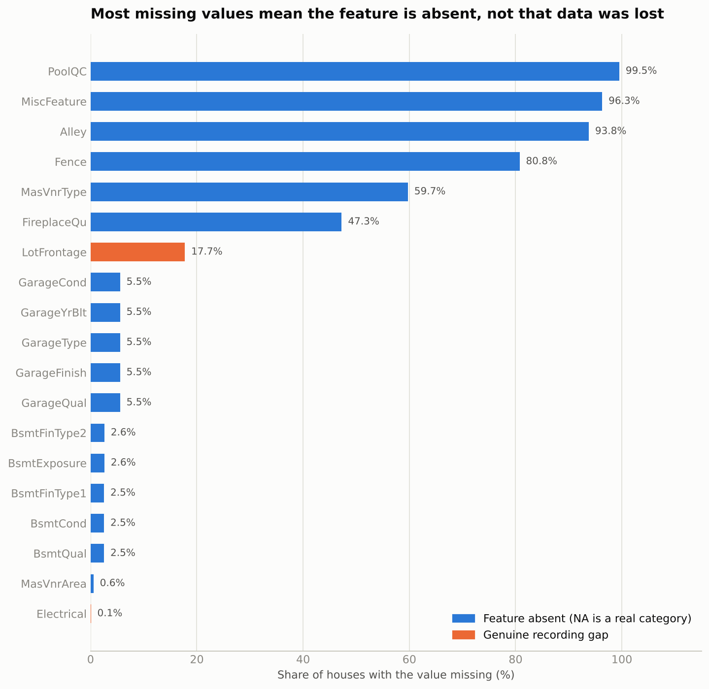
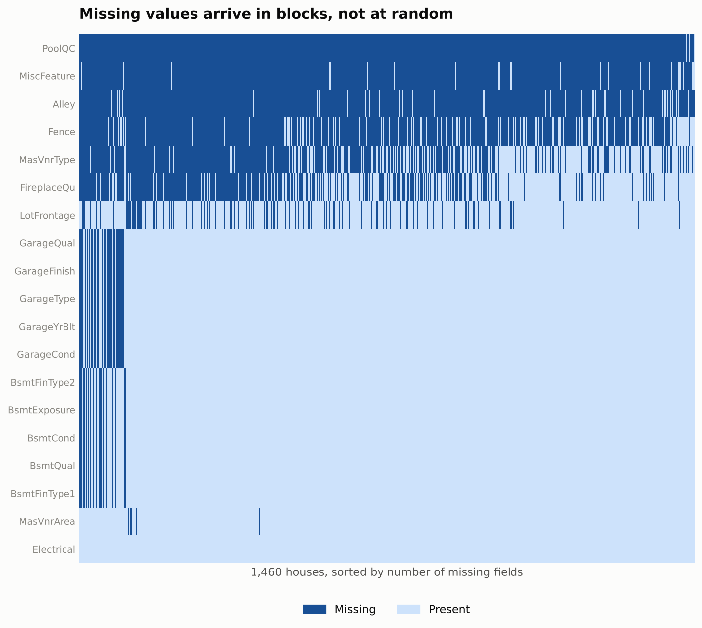
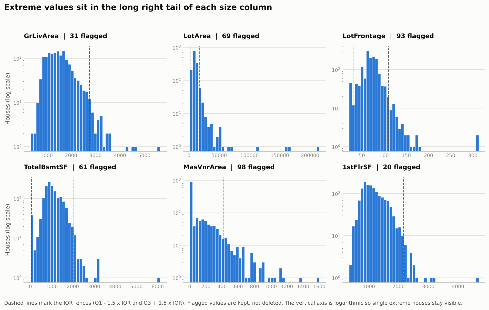
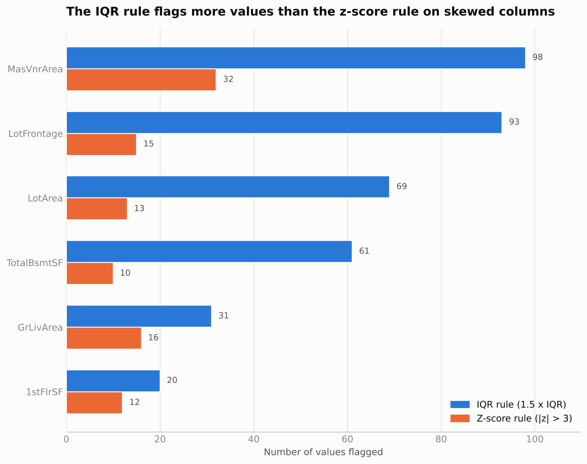

# AmesClean: Data Quality Report

**Ames Housing (House Prices, Regression Track)** | NeuroFive Internship, Week 1, Machine Learning | 10 October 2026

## Executive summary

- The raw file has 1460 houses and 81 columns; 19 columns contain missing values (7,829 missing cells in total).
- Most gaps are meaningful: the feature does not exist (no pool, garage, basement, fence, alley, fireplace). They became the category None instead of being filled with a mean or dropped.
- Only LotFrontage and Electrical look like genuine recording gaps and were imputed with a neighborhood median and the most frequent category.
- Exact duplicate rows: 0. Near-duplicate pairs reviewed: 4. Rows removed: 0.
- 6 numeric columns were screened for outliers with the IQR rule and the z-score rule. Extreme values were flagged, not deleted.
- 48 columns were re-typed (codes to categories, quality scales to ordered categories).
- The target SalePrice was not used in any cleaning decision and was verified unchanged: True.

## 1. Dataset overview

- Source: Kaggle, House Prices - Advanced Regression Techniques (Ames Housing), train.csv
- Raw shape: 1460 rows x 81 columns
- Cleaned shape: 1460 rows x 89 columns (the extra columns are missing-value indicators and outlier flags)
- Target variable: SalePrice (regression problem)
- Scaling and encoding are intentionally not done here, they belong to the modeling stage in Week 2

## 2. Missing-value report

pandas reads the literal text NA as a missing value, and in this dataset NA very often means the feature is absent, for example no pool or no garage. The full count and percent for every column is saved in missing_value_report.csv.

| Column | Missing count | Missing % | Dtype |
| --- | --- | --- | --- |
| PoolQC | 1453 | 99.52 | str |
| MiscFeature | 1406 | 96.3 | str |
| Alley | 1369 | 93.77 | str |
| Fence | 1179 | 80.75 | str |
| MasVnrType | 872 | 59.73 | str |
| FireplaceQu | 690 | 47.26 | str |
| LotFrontage | 259 | 17.74 | float64 |
| GarageQual | 81 | 5.55 | str |
| GarageFinish | 81 | 5.55 | str |
| GarageType | 81 | 5.55 | str |
| GarageYrBlt | 81 | 5.55 | float64 |
| GarageCond | 81 | 5.55 | str |
| BsmtFinType2 | 38 | 2.6 | str |
| BsmtExposure | 38 | 2.6 | str |
| BsmtCond | 37 | 2.53 | str |
| BsmtQual | 37 | 2.53 | str |
| BsmtFinType1 | 37 | 2.53 | str |
| MasVnrArea | 8 | 0.55 | float64 |
| Electrical | 1 | 0.07 | str |

Conceptually, most of these gaps are not missing completely at random. The garage, basement, pool, fence, alley and fireplace columns are missing because the house does not have that feature, which is a not-at-random pattern that carries real information. Treating them as random gaps and filling with a mean would destroy that information. Only LotFrontage and Electrical look like true recording gaps.

## 3. Missing-value decisions

| Column | Rows filled | Strategy | Why |
| --- | --- | --- | --- |
| Alley | 1369 | Impute with category None | NA in the source means no alley access, which is a real category |
| PoolQC | 1453 | Impute with category None | NA means the house has no pool, so the quality rating does not apply |
| Fence | 1179 | Impute with category None | NA means the house has no fence |
| MiscFeature | 1406 | Impute with category None | NA means no miscellaneous feature such as a shed or tennis court |
| FireplaceQu | 690 | Impute with category None | NA means the house has no fireplace |
| GarageType | 81 | Impute with category None | NA means the house has no garage |
| GarageFinish | 81 | Impute with category None | NA means the house has no garage |
| GarageQual | 81 | Impute with category None | NA means the house has no garage |
| GarageCond | 81 | Impute with category None | NA means the house has no garage |
| BsmtQual | 37 | Impute with category None | NA means the house has no basement |
| BsmtCond | 37 | Impute with category None | NA means the house has no basement |
| BsmtExposure | 38 | Impute with category None | NA means the house has no basement |
| BsmtFinType1 | 37 | Impute with category None | NA means the house has no basement |
| BsmtFinType2 | 38 | Impute with category None | NA means the house has no basement |
| MasVnrType | 872 | Impute with category None | Missing veneer type goes with missing veneer area, meaning no masonry veneer |
| LotFrontage | 259 | Impute with neighborhood median plus indicator column LotFrontage_was_missing | Every house touches a street so the value exists but was not recorded; lots in the same neighborhood have similar frontage, and the indicator keeps the imputed rows visible |
| GarageYrBlt | 81 | Impute with YearBuilt plus indicator column GarageYrBlt_was_missing | Missing means no garage so no year exists; a mean year would invent a false date, YearBuilt keeps the column on a sensible scale and the indicator preserves the no garage signal |
| MasVnrArea | 8 | Impute with value 0 | Missing veneer area means no masonry veneer, so the true area is zero |
| Electrical | 1 | Impute with most frequent category SBrkr | Only a handful of rows are affected and every house has an electrical system, so the dominant category is the safest estimate |

No rows were dropped for missing values, because dropping any row with a single missing value would throw away most of the dataset and bias it towards houses that have every feature. No column was dropped for the same reason: even PoolQC, which is almost entirely missing, is meaningful as the category None.

## 4. Duplicate check

- Exact duplicate rows: 0
- Duplicate rows when Id is ignored: 0
- Duplicate rows on feature columns only: 0
- Rows sharing all of Neighborhood, YearBuilt, LotArea, GrLivArea, OverallQual, TotalBsmtSF: 31
- Near-duplicate pairs (differing in at most 2 of 79 feature columns): 4
- Rows removed: 0

Rows that only share a few key columns can be different houses, so they were reviewed but not removed. Only exact duplicate records are removed.

## 5. Outlier analysis

Outliers were detected with the IQR rule (1.5 x IQR fences) and with the z-score rule (absolute z above 3). Nothing was capped or deleted. Each column got a 0/1 flag column named column_outlier_flag so the decision can be revisited later.

| Column | Min | Max | Lower fence | Upper fence | IQR outliers | Z-score outliers | Decision | Why |
| --- | --- | --- | --- | --- | --- | --- | --- | --- |
| GrLivArea | 334.0 | 5642.0 | 158.62 | 2747.62 | 31 | 16 | Genuine extreme value, flag and keep | Very large living areas are real big houses, not typing mistakes; the value agrees with the floor area columns where those are available |
| LotArea | 1300.0 | 215245.0 | 1481.5 | 17673.5 | 69 | 13 | Genuine extreme value, flag and keep | Very large lots are plausible for rural or acreage properties and lot size is naturally right skewed |
| LotFrontage | 21.0 | 313.0 | 30.0 | 110.0 | 93 | 15 | Possible data issue, flag and keep for review | Extreme frontage is unusual compared with lot area and part of it was imputed, so it is flagged rather than removed |
| TotalBsmtSF | 0.0 | 6110.0 | 42.0 | 2052.0 | 61 | 10 | Genuine extreme value, flag and keep | A very large basement matches a very large house and is physically possible |
| MasVnrArea | 0.0 | 1600.0 | -246.38 | 410.62 | 98 | 32 | Genuine extreme value, flag and keep | Most houses have zero veneer so any real veneer area looks extreme by IQR, which is a property of the distribution not an error |
| 1stFlrSF | 334.0 | 4692.0 | 118.12 | 2155.12 | 20 | 12 | Genuine extreme value, flag and keep | Large first floor area goes with very large houses and is physically plausible |

Cross-check: 31 of 31 flagged GrLivArea rows equal the sum of 1stFlrSF, 2ndFlrSF and LowQualFinSF, which supports treating them as genuine large houses rather than entry errors.

## 6. Type corrections

| Column | From | To | Reason |
| --- | --- | --- | --- |
| MSSubClass | int64 | category | Numeric looking code or month number with no arithmetic meaning |
| MoSold | int64 | category | Numeric looking code or month number with no arithmetic meaning |
| ExterQual | str | ordered category | Quality ratings have a natural order from Po to Ex |
| ExterCond | str | ordered category | Quality ratings have a natural order from Po to Ex |
| BsmtQual | str | ordered category | Quality ratings have a natural order from Po to Ex |
| BsmtCond | str | ordered category | Quality ratings have a natural order from Po to Ex |
| HeatingQC | str | ordered category | Quality ratings have a natural order from Po to Ex |
| KitchenQual | str | ordered category | Quality ratings have a natural order from Po to Ex |
| FireplaceQu | str | ordered category | Quality ratings have a natural order from Po to Ex |
| GarageQual | str | ordered category | Quality ratings have a natural order from Po to Ex |
| GarageCond | str | ordered category | Quality ratings have a natural order from Po to Ex |
| PoolQC | str | ordered category | Quality ratings have a natural order from Po to Ex |
| GarageYrBlt | float64 | int64 | A year is a whole number |
| MSSubClass | str | category | Text column with a fixed set of labels |
| MSZoning | str | category | Text column with a fixed set of labels |
| Street | str | category | Text column with a fixed set of labels |
| Alley | str | category | Text column with a fixed set of labels |
| LotShape | str | category | Text column with a fixed set of labels |
| LandContour | str | category | Text column with a fixed set of labels |
| Utilities | str | category | Text column with a fixed set of labels |
| LotConfig | str | category | Text column with a fixed set of labels |
| LandSlope | str | category | Text column with a fixed set of labels |
| Neighborhood | str | category | Text column with a fixed set of labels |
| Condition1 | str | category | Text column with a fixed set of labels |
| Condition2 | str | category | Text column with a fixed set of labels |
| BldgType | str | category | Text column with a fixed set of labels |
| HouseStyle | str | category | Text column with a fixed set of labels |
| RoofStyle | str | category | Text column with a fixed set of labels |
| RoofMatl | str | category | Text column with a fixed set of labels |
| Exterior1st | str | category | Text column with a fixed set of labels |
| Exterior2nd | str | category | Text column with a fixed set of labels |
| MasVnrType | str | category | Text column with a fixed set of labels |
| Foundation | str | category | Text column with a fixed set of labels |
| BsmtExposure | str | category | Text column with a fixed set of labels |
| BsmtFinType1 | str | category | Text column with a fixed set of labels |
| BsmtFinType2 | str | category | Text column with a fixed set of labels |
| Heating | str | category | Text column with a fixed set of labels |
| CentralAir | str | category | Text column with a fixed set of labels |
| Electrical | str | category | Text column with a fixed set of labels |
| Functional | str | category | Text column with a fixed set of labels |
| GarageType | str | category | Text column with a fixed set of labels |
| GarageFinish | str | category | Text column with a fixed set of labels |
| PavedDrive | str | category | Text column with a fixed set of labels |
| Fence | str | category | Text column with a fixed set of labels |
| MiscFeature | str | category | Text column with a fixed set of labels |
| MoSold | str | category | Text column with a fixed set of labels |
| SaleType | str | category | Text column with a fixed set of labels |
| SaleCondition | str | category | Text column with a fixed set of labels |

## 7. Logical consistency checks

- YearRemodAdd earlier than YearBuilt: 0
- YearBuilt later than YrSold: 0
- GarageYrBlt later than YrSold: 0
- Negative values in numeric columns: 0
- Near-constant columns (99 percent or more one value): Street (99.59%), Utilities (99.93%), PoolArea (99.52%), PoolQC (99.52%)

Near-constant columns carry almost no information but are kept for now; whether to drop them is a modeling-stage decision.

## 8. Leakage risk (flagged, not fixed yet)

The medians, the most frequent categories and the IQR fences above were computed on the full raw dataset because this task is a cleaning exercise before any train/test split. Once splitting begins in Week 2, every such statistic must be computed from the training data only and then applied to the test data, otherwise information from the test set leaks into training.

## 9. Deliverables

- ames_cleaned.csv: cleaned dataset
- missing_value_report.csv: count and percent of missing values for every column
- DATA_QUALITY_REPORT.md: this report
- figures/: the five charts used in this report
